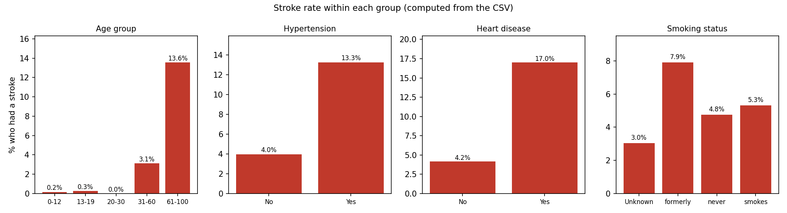
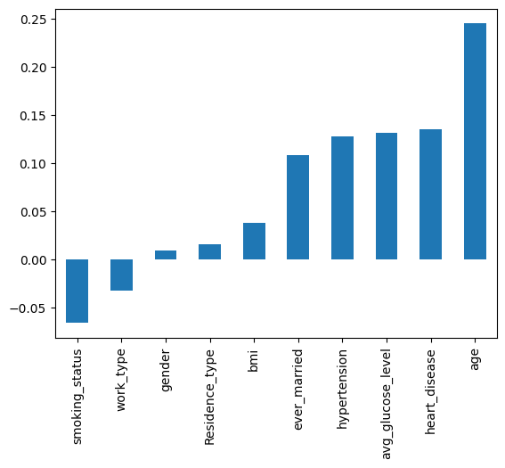
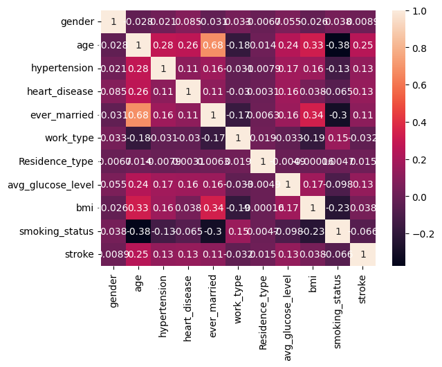
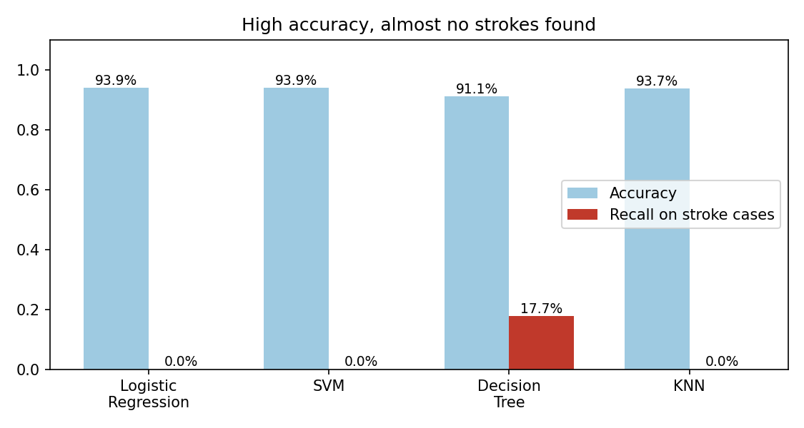
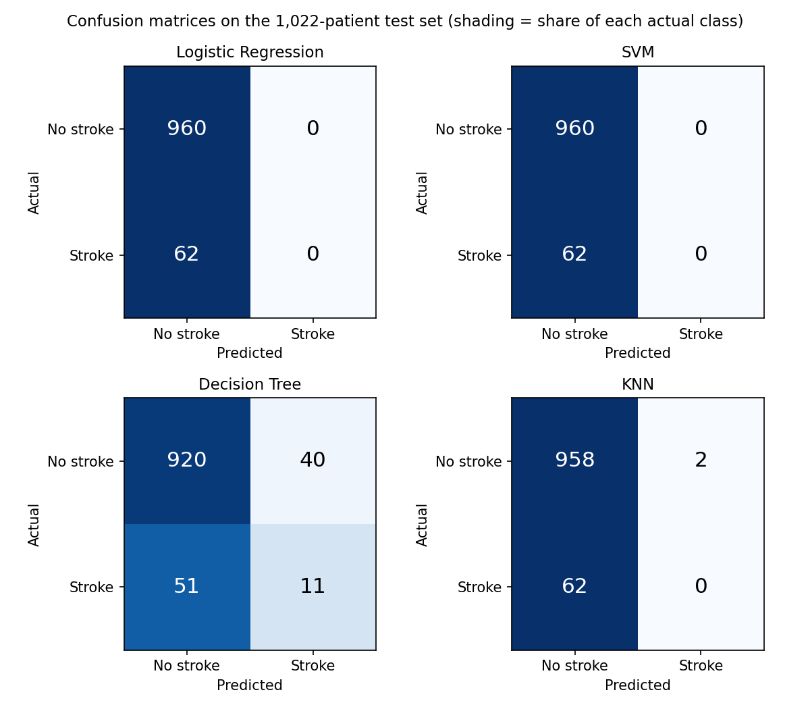

<p align="center">
  
</p>

# Stroke Prediction

Can you predict whether someone will have a stroke from basic health information like age, blood pressure history, heart disease, glucose level, BMI and smoking status? I took a Kaggle dataset of 5,110 patients, cleaned it, explored it, and trained four classifiers: logistic regression, SVM, decision tree and KNN.

At first glance the results look great. Three of the four models scored 93.9% accuracy. But when I looked closer, those three models never predicted a single stroke. Only about 6% of the test patients had a stroke, so a model that says "no stroke" for everybody gets 94% for free. That turned out to be the most important thing I learned in this project, and the report is built around it.

The longer write-up is in [REPORT.pdf](REPORT.pdf) and all of the code is in `Heart-stroke-detection-final.ipynb`.

> This is a learning project. It is not a medical tool and nothing here should be used to make health decisions.

## Dataset

Source: [Stroke Prediction Dataset on Kaggle](https://www.kaggle.com/datasets/fedesoriano/stroke-prediction-dataset) by fedesoriano. It has 5,110 rows and 12 columns. I dropped `id`.

| Column | What it is |
| --- | --- |
| gender | Male, Female or Other (only 1 patient is "Other") |
| age | Age in years |
| hypertension | 1 if the patient has hypertension |
| heart_disease | 1 if the patient has a heart disease |
| ever_married | Yes or No |
| work_type | Private, Self-employed, Govt_job, children or Never_worked |
| Residence_type | Urban or Rural |
| avg_glucose_level | Average glucose level in the blood |
| bmi | Body mass index (201 values are missing) |
| smoking_status | formerly smoked, never smoked, smokes or Unknown |
| stroke | 1 if the patient had a stroke (the target) |

Only 249 of the 5,110 patients (4.9%) had a stroke. That imbalance is why accuracy turns out to be such a misleading number here.

## What I found in the data

My notebook mostly used count plots, which show how many people are in each group, not how likely each group is to have a stroke. So I recomputed the stroke **rate** within each group from the CSV, and that's the chart below. It tells a clearer story than the counts did:

- **Age** is by far the strongest factor. 13.6% of patients over 60 had a stroke, against 3.1% for ages 31 to 60 and almost none below 30.
- **Hypertension** (13.3% vs 4.0%) and **heart disease** (17.0% vs 4.2%) both roughly triple the rate.
- **Smoking** is less clear. Former smokers have the highest rate (7.9%), current smokers 5.3%, never-smokers 4.8%. Patients with "Unknown" status have 3.0%, which is partly because that group includes many children.
- Married patients, self-employed patients and patients with a higher glucose level also have higher rates, but age is mixed in with all of these.

<p align="center">
  
</p>

<p align="center">
  
  
</p>

## How it works

1. Drop `id` and fill the 201 missing `bmi` values with the most common value (28.7).
2. Convert the text columns to numbers by hand (for example Yes = 1, No = 0).
3. Group `age` into five bands: 0 to 12, 13 to 19, 20 to 30, 31 to 60 and 61 to 100.
4. Split 80/20 with `random_state=42`. That gives 4,088 training and 1,022 test patients, of whom 62 had a stroke.
5. Train logistic regression, SVM, decision tree and KNN with default settings.
6. Compare accuracy, F1, MAE, MSE and log loss.

## Results

| | Logistic regression | SVM | Decision tree | KNN |
| --- | --- | --- | --- | --- |
| Accuracy | 0.939 | 0.939 | 0.911 | 0.937 |
| F1 (stroke class) | 0.00 | 0.00 | 0.19 | 0.00 |
| Strokes found (of 62) | 0 | 0 | 11 | 0 |
| False alarms | 0 | 0 | 40 | 2 |

<p align="center">
  
</p>

Logistic regression and SVM predicted "no stroke" for all 1,022 test patients. KNN predicted "stroke" twice and was wrong both times. Only the decision tree found any strokes: 11 of 62, at the price of 40 false alarms. Its accuracy is the lowest of the four, but it's the only one that's doing anything useful.

<p align="center">
  
</p>

The decision tree has no `random_state`, so its numbers change each time you run it. When I re-ran the same preprocessing I got 90.6% accuracy and 14 strokes found, not 91.1% and 11.

<details>
<summary><b>Running it</b> (click to expand)</summary>

You need Python 3.9+ and:

```
pip install pandas numpy matplotlib seaborn scikit-learn jupyter
```

The notebook was written in Google Colab and loads the data from Google Drive:

```python
df = pd.read_csv('./drive/MyDrive/healthcare-dataset-stroke-data.csv')
```

To run it locally, delete the `drive.mount` cell and change the path to `pd.read_csv('healthcare-dataset-stroke-data.csv')`. The CSV is included in this repo.

Logistic regression may print a convergence warning because the inputs aren't scaled. It still runs.

</details>

## Things I'd fix or try next

- **Accuracy is the wrong metric here.** The conclusion in my notebook says all four models are about equally good and that "we can use any of these models to predict the heart stroke". That's not true: three of them never predict a stroke. I should look at recall, precision, F1 and ROC AUC instead, and I should have noticed that F1 = 0.0 in my own output.
- **Deal with the imbalance.** Try `class_weight='balanced'`, oversampling (SMOTE), or a lower decision threshold, and use `stratify=y` in the split so the test set has the same stroke rate.
- **My notes about the charts were wrong.** I wrote that people *without* hypertension or heart disease have a higher chance of stroke, and that non-smokers have a higher chance than smokers. I was reading counts, not rates. There are simply many more people without those conditions. The rates chart above shows the opposite for hypertension and heart disease, and a much weaker effect for smoking. The note about BMI between 20 and 50 is the same: that's where most patients are.
- **Missing BMI.** I filled all 201 gaps with the mode. Patients with a missing BMI actually had a stroke rate of about 20% (from my recheck), much higher than average, so a constant fill hides something. A median fill with a "was missing" flag would be better.
- **Encoding.** Smoking status and work type got arbitrary numeric codes, which models treat as ordered. One-hot encoding is the right thing. Also no scaling for logistic regression, SVM and KNN, which depend on it.
- **Binning age** into five groups throws away information, and age is the strongest feature.
- **Metrics that don't fit.** MAE and MSE are identical for 0/1 predictions (both are just the error rate), and I computed log loss on hard 0/1 predictions instead of probabilities, so those numbers (about 2.2 to 3.2) don't mean much.
- **Numbers in my conclusion don't match.** I wrote 93.8% for three models and 91.8% for the tree. The outputs show 93.9%, 93.9%, 93.7% and 91.1%.
- **One split, default settings.** Cross-validation and tuning would help, as would a random forest or gradient boosting model.
- The notebook is called "heart stroke", but this is about stroke. Heart disease is one of the input features.

## Files

```
.
├── assets/                                  # banner and plots used in this README
├── Heart-stroke-detection-final.ipynb       # the whole analysis
├── healthcare-dataset-stroke-data.csv       # data (from Kaggle)
├── REPORT.pdf                               # longer write-up
└── README.md
```

## Author

Yash Jain
